# podcast-motion-skills

A framework of Claude Code skills for making a podcast or talk-show film of about 2 to 30 minutes. Bring a recording, audio alone, or just a topic and a script. It handles the voices or the sound clean-up, the transcript, the edit, the on-screen graphics, subtitles and mastering, and you choose how the film looks.

You describe the job in plain words, and the skills run it in stages. They stop for the decisions that are yours: which moments, which voice by ear, which look, and the final preview. Nothing that costs money runs until you've seen the price.

| Skill | What it does | Needs a cutout | Status |
|---|---|---|---|
| `podcast-playbook` | The method: script or sound, transcript, cut, review, master, publish | | Run end to end on one real episode and one scripted film, except publishing |
| `podcast-motion-studio-cut` | Real footage with typographic label cards. Quiet and trustworthy | No | Built on a real episode |
| `podcast-motion-pop-studio` | Speakers cut out on flat colour, a painted TV set. Lively | Yes | Built on a real episode |
| `podcast-motion-animatic` | Storyboard panels in stepped motion, with optional cards beside the speaker, pictures that move with the story and a themed ground. For footage, audio-only shows or scripted shows with drawn hosts | No | Built on a scripted film; test frames on footage |
| `podcast-motion-caption-first` | Clean footage, large captions, one big moment. Cheapest | No | Rendered on a scripted film; test frames on footage |
| `podcast-motion-whiteboard` | Footage beside a board that draws what the guest says | No | Rendered on a scripted film; test frames on footage |
| `podcast-motion-morning-show` | Lower thirds and a topic strip, a format viewers know | No | Rendered on a scripted film; test frames on footage |
| `podcast-motion-photo-card` | The speaker beside a white card: heading, rows on their words, and a full-colour picture that moves. Built on the Animatic's card engine | No | Rendered on a scripted film |
| `podcast-motion-chalkboard` | The speaker beside a green board: chalk heading and rows, pictures turned to chalk sketches. Built on the Animatic's card engine | No | Rendered on a scripted film |
| `podcast-motion-comic` | Speakers inked onto a halftone page that changes colour with each card, comic panels with speech bubbles, a starburst on every number | Yes | Rendered on a scripted film |
| `podcast-motion-evidence` | A cork wall: cards pinned as polaroids with sticky notes, then strung along the ledge, so the board fills up as the case is made | Yes | Rendered on a scripted film |
| `podcast-motion-bento` | The footage becomes a tile, and every card reflows the grid with tiles for the heading, the picture and each row | No | Rendered on a scripted film |
| `podcast-motion-chat` | The talk as a messaging app: typing, messages from whoever said them, image messages and stickers, in a feed that keeps the chapter | Yes | Rendered on a scripted film |

## Showcase

One 2-minute Thai film about *Project Hail Mary*, built in all twelve looks from the same script, voices and cut. Click a picture to play its film (720p previews, about 5 MB each).

| | | |
|---|---|---|
| [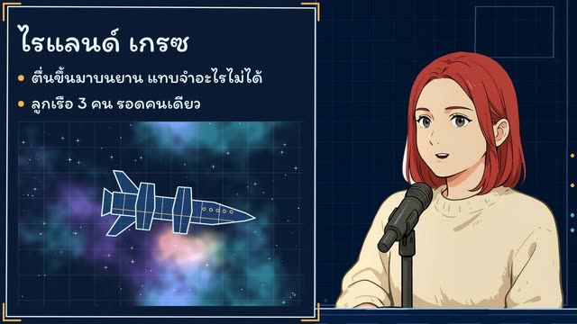](showcases/hailmary_animatic.mp4)<br>**Animatic** · [mp4](showcases/hailmary_animatic.mp4) | [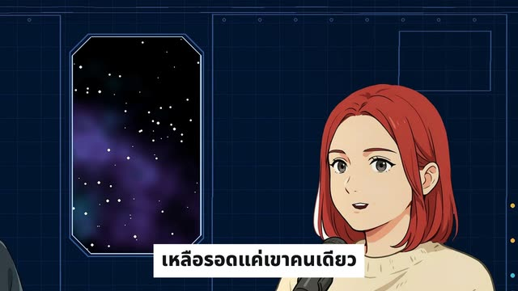](showcases/hailmary_caption_first.mp4)<br>**Caption-First** · [mp4](showcases/hailmary_caption_first.mp4) | [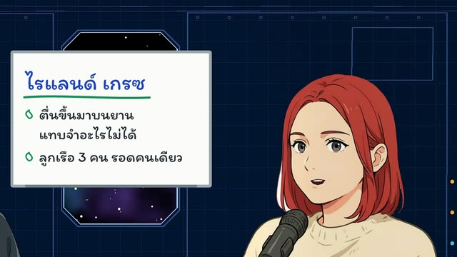](showcases/hailmary_whiteboard.mp4)<br>**Whiteboard** · [mp4](showcases/hailmary_whiteboard.mp4) |
| [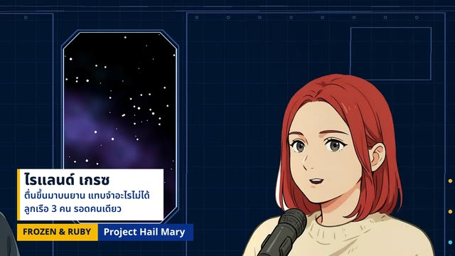](showcases/hailmary_morning_show.mp4)<br>**Morning Show** · [mp4](showcases/hailmary_morning_show.mp4) | [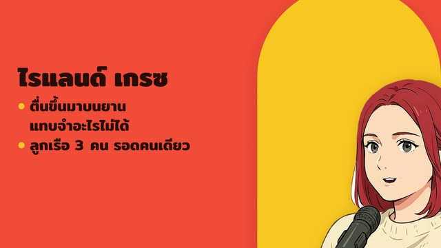](showcases/hailmary_pop_studio.mp4)<br>**Pop Studio** · [mp4](showcases/hailmary_pop_studio.mp4) | [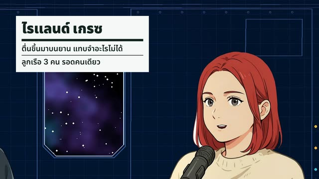](showcases/hailmary_studio_cut.mp4)<br>**Studio Cut** · [mp4](showcases/hailmary_studio_cut.mp4) |
| [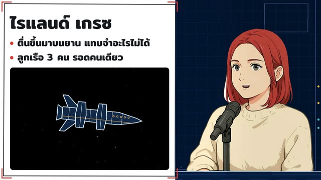](showcases/hailmary_photo_card.mp4)<br>**Photo Card** · [mp4](showcases/hailmary_photo_card.mp4) | [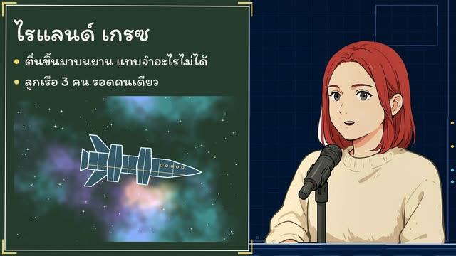](showcases/hailmary_chalkboard.mp4)<br>**Chalkboard** · [mp4](showcases/hailmary_chalkboard.mp4) | [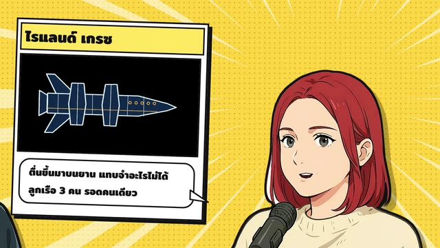](showcases/hailmary_comic.mp4)<br>**Comic** · [mp4](showcases/hailmary_comic.mp4) |
| [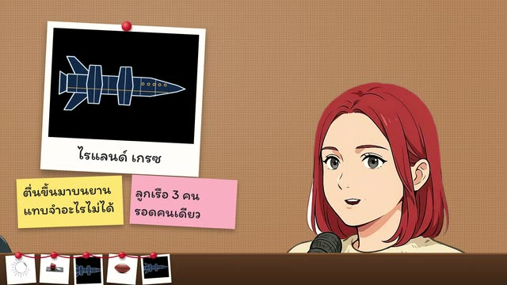](showcases/hailmary_evidence.mp4)<br>**Evidence Board** · [mp4](showcases/hailmary_evidence.mp4) | [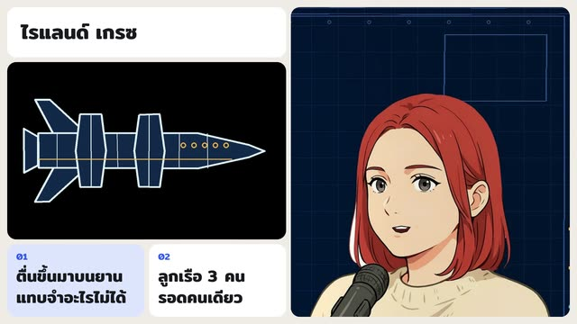](showcases/hailmary_bento.mp4)<br>**Bento Grid** · [mp4](showcases/hailmary_bento.mp4) | [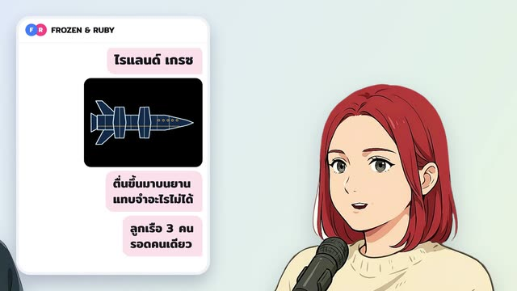](showcases/hailmary_chat.mp4)<br>**Chat Feed** · [mp4](showcases/hailmary_chat.mp4) |

How it was made, with no recording:

- **Script:** the 29 lines in `podcast-motion-animatic/examples/hail-mary/script.json`, with a source for every claim.
- **Hosts:** Frozen and Ruby, cast from a written description with Ideogram 4.5 on Comfy Cloud, two options each, then a blink frame by Precise Edit. Mouths are painted in code. About 109 Comfy credits.
- **Voices:** ElevenLabs `eleven_v4`, WWO ATSAWIN and WWO Mali, chosen from the free previews. 588 credits for 1,335 characters. The voices are synthetic.
- **Pictures:** the sun, Rocky, the ship and the nebula are drawn in code by `draw_art.py`. Four object stills came from Ideogram, about 72 Comfy credits.
- **Cut and master:** 1:58.8, each film −14 LUFS (Pop Studio −14.2, to keep its peaks under the limit), true peak ≤ −1 dBTP, 7/7 QC checks.

Each look was rendered as its build made it, with nothing retouched afterwards. One input differs from a recorded show: the cutout that Pop Studio, Comic, Evidence Board and Chat Feed stand the hosts on comes from the drawn hosts' own alpha, because the person matte, trained on real people, lost Ruby's head. Not yet fixed: Caption-First's subtitles are a draft no one has proofread, Pop Studio crops Ruby's hair at the frame edge in her close-ups, and Studio Cut breaks one Thai heading mid-word. Rocky is drawn from the novel's description, not the film's design.

## What you can bring

| You have | What happens | Looks that fit |
|---|---|---|
| Two people on one camera | The full pipeline: one camera is recut as if it were two | Any |
| A finished episode, and you want clips | Finds the moments, then reuses the episode's sound and transcript, so a clip costs almost nothing new | Any. Caption-First is the cheapest |
| Audio only, no camera | The same pipeline over a plain video | Animatic, Photo Card, Chalkboard |
| A topic or a script, and no recording | Writes or takes the script, casts voices from free previews, and voices it. Drawn hosts are optional | Any: the showcase is all twelve on one scripted film |
| One person, or three or more | **Not proven.** The shot planner assumes two people, one each side of the frame | Try test frames first |

## Choosing a look

There is no default. The skill asks each time, and each show's `STYLES.md` records what it has approved or ruled out. Every look shows you real test frames before any long render.

| If the show is | Try |
|---|---|
| Expert, serious, trust is the point | Studio Cut |
| A story, or a topic you can draw: film, science, history | Animatic, with cards and a theme from the story |
| Someone teaching or explaining | Whiteboard, or Chalkboard for a classroom feel |
| An explainer where the object itself matters: a product, a place, a dish | Photo Card |
| Friendly or loud, made to stop the scroll | Pop Studio, or Comic for something louder |
| A mystery or a case argued step by step | Evidence Board |
| Calm, modern, product or keynote talk | Bento Grid |
| Social and conversational, for a phone audience | Chat Feed |
| News, or a familiar broadcast feel | Morning Show |
| A Short that has to work with the sound off, or the smallest budget | Caption-First |

## Choosing a length

The same pipeline covers the whole range, and what changes is the structure around the talk. Credits are measured where a real film ran at that length, and scaled from those rates where the last column says so.

| Runtime | Build it as | Structure | Cards | ElevenLabs credits | Ideogram credits | Run at this length? |
|---|---|---|---|---|---|---|
| **2 to 5 min** | A clip: `--clip EP01/C01_name` | One chapter, no cold open or title, a 3 s end card | About one every 8 to 10 s. Something new every 2 to 4 s | Scripted: about 300 a minute. From a processed episode: 0. Isolating only the clip's range: about 700 | About 18 each, usually 7 to 14 | Yes: a 2-minute scripted film, and clips |
| **5 to 15 min** | An episode: `--episode EP01` | A cold open, a 3.2 s title, 2 s chapter cards, an 8 s end card, 3 to 5 chapters | About one every 17 s | About 680 a minute of recording | About one picture a minute | **No.** Scaled from the two ends |
| **15 to 30 min** | An episode | The same, with 6 or more chapters. Expect the cut to lose a quarter: 30 minutes became 22 on the real one | About one every 17 s | About 20,400 for 30 minutes | About 400 for 22 pictures | Yes: one episode, recorded |

- **With neither key, the method still runs for free,** on ordinary denoise, a local transcript and the bundled music. Scripted voices are the one thing that needs ElevenLabs or your own microphone.
- **Rendering is free but not instant.** On a Mac, a 23-minute Studio Cut took about 11 minutes and a 2-minute Animatic with moving pictures about 5. On a 4-core Linux cloud machine with no GPU, each 2-minute showcase look took 24 to 44 minutes, Comic's ink outline the slowest. A look with many layers costs more per second, so measure on a short stretch before a long render.
- **A scripted show past about 5 minutes hasn't been tried.** Drawn hosts with flapping mouths may tire over a long film, so test a stretch first.

## How a run goes

```
 A. Ingest ─► B. Find the moments ★ ─► C. Clean the sound ★ ─► D. Lock the script ★ ─► E. Storyboard and look ★
                                                                                            │
 J. Publish ★ ◄─ I. Master + QC ◄─ H. Review + preview ★ ◄─ G. Edit ◄─ F. Assets (quoted) ◄─┘
```

★ is where it stops for you. A show with no recording starts at D with the script, and casting and voices stand in for A to C.

## Install

```bash
git clone https://github.com/ohmdob/podcast-motion-skills.git
cd podcast-motion-skills
./install.sh
```

`install.sh` links the skills into `$CLAUDE_CONFIG_DIR/skills`, or `~/.claude/skills` if that isn't set, so every Claude Code session can use them and `git pull` updates them. It also makes a private `.env` from `.env.example`. `./install.sh --uninstall` removes only those links.

**Don't move the skills apart.** The looks use the scripts in `podcast-playbook`, and several build on the Animatic's engine in `podcast-motion-animatic`, so keep the folders side by side.

### Use Claude Opus 5.5

These skills are written and tested for **Claude Opus 5.5**. Start Claude Code with it:

```bash
claude --model claude-opus-5-5
```

or pick it with `/model` in a session. Each skill also sets `model: claude-opus-5-5`, so the turn it runs in uses that model even if the session is on another one.

### What else you need

```bash
python3 .claude/skills/podcast-playbook/scripts/doctor.py
```

`doctor.py` says what's installed, which keys are set, and what each step will use. It's free and never prints a key.

- **Required:** `ffmpeg` 7 or later (the cut reads its filters from a file, which 6.x can't), Python 3 with `numpy` and `pillow`, Node.js. [HyperFrames](https://hyperframes.heygen.com) runs through `npx`, and `npx hyperframes skills` installs its own skills, which these point to for anything hand-built.
- **macOS, with the Xcode command line tools, for real footage.** Face tracking comes from Apple Vision, compiled with `swiftc`, and so do Thai word breaks in subtitles. A scripted show makes its own face tracking, so it builds anywhere: the showcase was built on Linux.
- **For Pop Studio, Comic, Evidence Board and Chat Feed:** `uv`, which runs the person matte. These four stand the speakers on a ground of their own.
- **For a scripted show:** `scipy` as well, which cuts drawn hosts out of their backgrounds.
- **Optional:** the [Codex CLI](https://github.com/openai/codex), for pictures when Ideogram isn't available.

## Keys

Put keys in `.env`, either in this folder or in any folder above it. It's ignored by git, so it never reaches the repo. A show's folder can have its own `.env`, and a blank line there falls back to this one.

```
COMFY_API=
ELEVENLABS_API=
```

**Either one is optional, and so is having both.**

| Key | Used for | Without it |
|---|---|---|
| `ELEVENLABS_API` | Voice isolation, transcript, word timing, music, effects, and voices for a scripted show | Ordinary denoise, any `.srt` or `npx hyperframes transcribe`, the bundled music and effects, and your own microphone for a script |
| `COMFY_API` | Pictures from Ideogram 4.5 on [Comfy Cloud](https://cloud.comfy.org). Get the key at [platform.comfy.org](https://platform.comfy.org/login) | The skill asks which alternative you want: Codex imagegen, your own photographs, or none |

To use a ComfyUI you run yourself instead of Comfy Cloud, add `COMFY_HOST=http://your-machine:8188`.

**Paid calls never run by surprise.** A paid command only quotes unless given `--yes`, nothing retries by itself, and every call gets a row in the show's `data/ledger.md`.

## Use

In Claude Code, describe the job. For example:

```
I've got a 30-minute recording at ~/shows/my-show/1080p/ep02.mp4. Take it through the playbook.
Find the best clips in this episode and make a Short from the first one.
Clean the audio on this recording. Let me hear the options before you mix anything.
Build this episode in the whiteboard look and show me test frames first.
I have no recording. Write a 2-minute Thai talk about this film for my two characters, and use the animatic look.
Keep the speaker on screen, with an image card and text beside them, and make the pictures move with the story.
```

You can also call a skill directly with `/podcast-playbook` or `/podcast-motion-whiteboard`.

The skill stops for you at each decision: which moments, which voice treatment by ear, which look, and the final preview. **There is no default look.** It asks each time, and each show's `STYLES.md` records what it has approved or ruled out.

### The steps, if you want to run them yourself

From this repo's folder, so the paths stay right after the `cd`:

```bash
REPO="$PWD"; S="$REPO/.claude/skills/podcast-playbook/scripts"
python3 $S/init_show.py ~/shows/my-show --name "My Show" --mark "MY SHOW" --lang tha
python3 $S/init_show.py ~/shows/my-show --episode EP02
cd ~/shows/my-show
F=episodes/EP02/full

# sound and words (no ElevenLabs key: see references/sound-and-script.md)
ffmpeg -i 1080p/ep02.mp4 -vn -ac 1 -ar 48000 -af "volume=30dB,alimiter=limit=0.89:attack=5:release=50" -c:a pcm_s16le $F/audio/boost.wav
python3 $S/el.py isolate $F/audio/boost.wav $F/audio/isolated.mp3         # quotes; add --yes to spend
python3 $S/el.py scribe  $F/audio/isolated.mp3 $F/audio/scribe.json
python3 $S/transcript.py rows $F/audio/scribe.json --md transcripts/EP02.md --rows $F/build/pass1.json --take 0:speaker_0=H,speaker_1=G
swiftc -O $S/faces.swift -o /tmp/faces && /tmp/faces 1080p/ep02.mp4 $F/build/faces.jsonl

# write paper.json and cards.json, then the cut
python3 $S/full_edit.py $F
python3 $S/full_edit.py $F --render

# a look, with test frames first
python3 "$REPO/.claude/skills/podcast-motion-whiteboard/scripts/build.py" $F --ratio both --frames

# render and master
(cd $F/variant_whiteboard && HF_SEGMENTED_CAPTURE=true npx hyperframes render --quality delivery --resume -o ../build/renders/full.mp4)
python3 $S/master_clip.py $F/build/renders/full.mp4 outputs/EP02.mp4 --audio $F/variant_whiteboard/assets/mix.wav
```

A show with no recording swaps the sound steps for these. `references/scripted-show.md` in `podcast-playbook` has the whole route, and `podcast-motion-animatic/examples/hail-mary/` holds a real film's files.

```bash
C=episodes/EP01/clips/C01_name
python3 $S/el.py voices --lang th --previews assets/casting            # free: hear them before you pay
python3 $S/el.py tts $C/script.json $C/audio/takes --voices H=ID,G=ID  # quotes; add --yes to spend
python3 $S/scripted_source.py $C                                       # the takes become the recording the cut expects
python3 $S/script_srt.py $C outputs/NAME.th.srt
```

Each skill's `SKILL.md` and `references/` hold the detail, including the mistakes already paid for.

## What is proven

Two real films have been through this, and they sit at the two ends of the range:

- **A 30-minute recorded episode:** one camera, two people, in Thai, 1920×1080, 25 fps, with the host on the left and the guest on the right. Studio Cut and Pop Studio were built on it.
- **A 2-minute scripted film:** no recording, two drawn hosts, ElevenLabs voices, in Thai, 16:9. Animatic, with cards and a blueprint theme, approved by its producer. All twelve looks were later rendered on the same film for the showcase above.

And what isn't:

- **Lengths between those two have not been run.** The 5 to 15 minute row above is scaled, not measured.
- **Other languages, frame rates, solo shows and three-person shows are not proven.** The cut and sound stages should carry over; the shot planner assumes two people on one camera, one each side.
- **Caption-First, Whiteboard and Morning Show are candidates.** So is Animatic on real footage. They have been checked on real frames, and rendered at full length only on the scripted showcase above. No producer has approved them.
- **Photo Card, Chalkboard, Comic, Evidence Board, Bento Grid and Chat Feed are newer still.** Each has been rendered once, on the scripted showcase. None has been run on real footage or approved by a producer.
- **Publishing is a plan.** It hasn't been run.
- **A person still has to listen.** Tools measure the sound, and they can't hear whether a voice is right. A scratch voice that passed every check was rejected in seconds.

`scripts/selftest.py` checks the promises around money and keys offline.

## Licences

- **Fonts** in `assets/fonts` (Mitr, Noto Sans Thai, Itim) are under the SIL Open Font License.
- **The matting model** (Peter Lin's [RobustVideoMatting](https://github.com/PeterL1n/RobustVideoMatting), GPL-3.0) isn't in this repo. It downloads on first use and is checked against a pinned hash.
- **The music and effects** in `assets/` were generated with ElevenLabs. Check their terms for your own use, and replace them with your show's own when you can.
- **Characters and films in your own show are yours to clear.** The worked example draws a character from a novel, so check before publishing anything like it.
